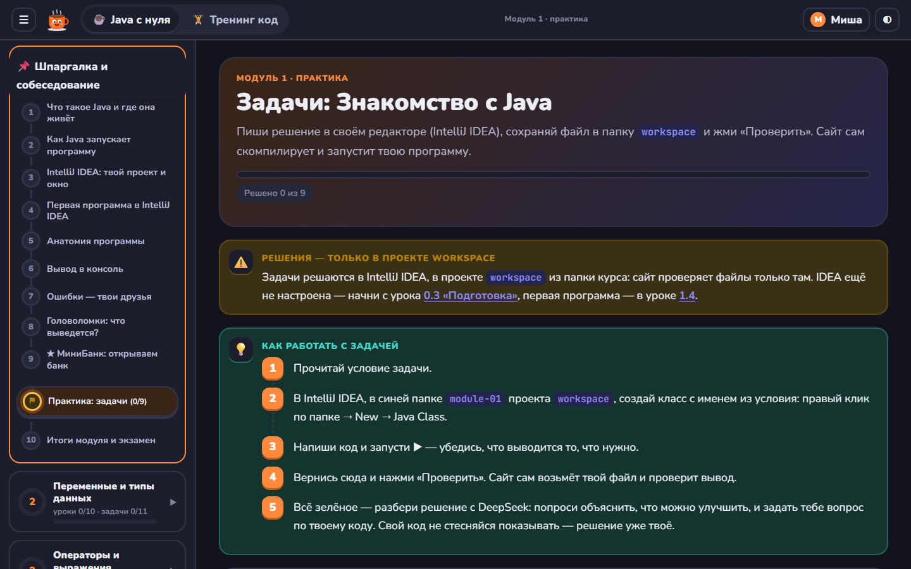
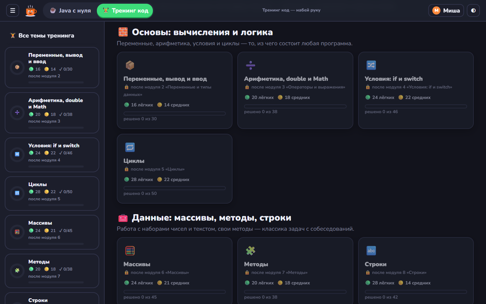
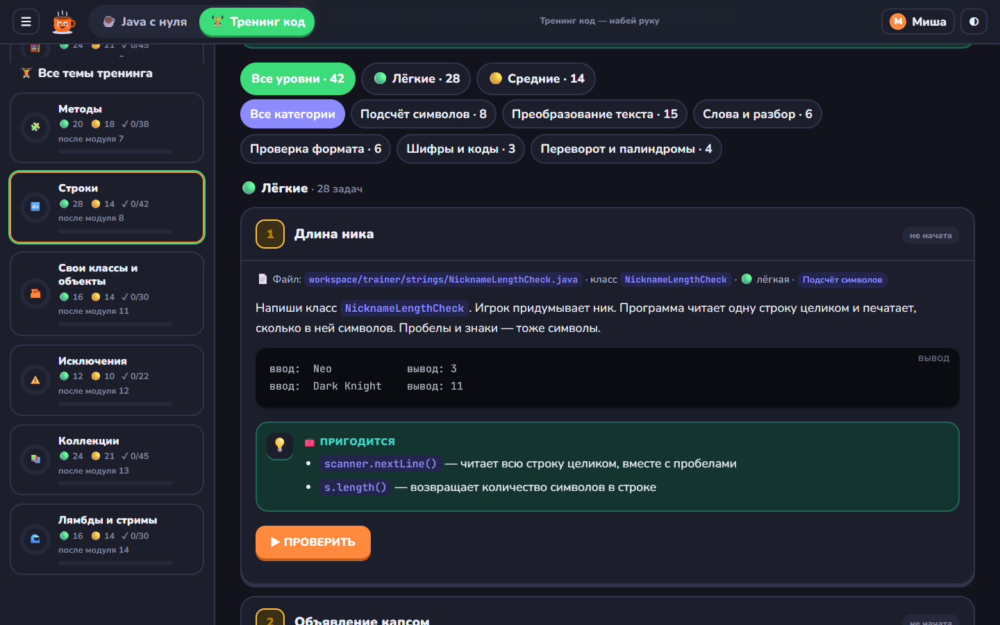

# ☕ Java с нуля — курс с ИИ-наставником

Курс для тех, кто никогда не программировал. Цель — уверенно писать программы на Java. Уроки с картинками и аналогиями, задачи с автопроверкой, раздел «🏋️ Тренинг код» с сотнями задач, чтобы набить руку, и ИИ-помощник, который **не пишет код за тебя**, а подсказывает и объясняет.

Курс работает у тебя на компьютере: сайт и проверка задач запускаются в Docker, код ты пишешь в IntelliJ IDEA.

## 🗺 Из чего состоит курс

Курс рассчитан на изучение Java, а затем — автотестов. Он состоит из двух больших блоков, и второй вырастает из первого:

| Блок | Что внутри | Статус |
|---|---|---|
| **1. Java с нуля** | 18 модулей: от первой программы до коллекций, стримов, файлов, многопоточности, Git и тестов на JUnit. Сквозной проект «МиниБанк» и «Тренинг код» с сотнями задач | ✅ готов |
| **2. Автотесты** | как устроены веб-страницы, локаторы, Selenide, Page Object, API-тесты и свой проект автотестов — на крепкой Java из первого блока | 🛠 в разработке |

Сначала проходится блок про Java: без уверенной Java автотесты не получатся. Когда выйдет блок автотестов, курс обновится — сайт сам покажет значок **«🔄 Обновление»** (см. «Обновление курса»).

---

## 🚀 Как начать с нуля

Инструкция для Windows. На macOS и Linux всё так же, только вместо PowerShell — «Терминал».

### Шаг 1. Установи Git

Git нужен, чтобы скачать курс и потом одной командой получать обновления.

1. Скачай установщик: https://git-scm.com/download/win
2. Запусти и жми **Next** до конца — настройки по умолчанию подходят.

> Не хочешь ставить Git? На странице репозитория нажми зелёную кнопку **Code → Download ZIP** и распакуй архив в папку `C:\Users\<твоё имя>\IdeaProjects\java-course`. Минус — обновлять курс придётся вручную (см. «Обновление курса»).

### Шаг 2. Установи Docker Desktop

Docker запускает сайт курса и сервер, который проверяет твои задачи. Ничего, кроме него, для сайта ставить не нужно — Java для сервера он скачает сам.

1. Скачай: https://www.docker.com/products/docker-desktop/
2. Установи с настройками по умолчанию. Если установщик попросит включить **WSL 2** или перезагрузить компьютер — соглашайся.
3. Запусти **Docker Desktop** и подожди, пока внизу слева появится зелёное **Engine running**. Регистрироваться не обязательно — можно пропустить.

### Шаг 3. Скачай курс

Открой **PowerShell** (кнопка «Пуск» → набери `PowerShell` → Enter) и выполни команды по одной:

```powershell
mkdir $HOME\IdeaProjects -Force
```

```powershell
cd $HOME\IdeaProjects
```

```powershell
git clone https://github.com/abramovalera/java-auto.git java-course
```

```powershell
cd java-course
```

Теперь курс лежит в папке `C:\Users\<твоё имя>\IdeaProjects\java-course`.

### Шаг 4. Запусти сайт курса

В том же окне PowerShell (ты должен быть в папке `java-course`):

```powershell
docker compose up -d --build
```

Первый запуск занимает 2–5 минут: Docker скачивает Java и собирает сервер. Готово, когда в конце появится строка `Container java-course  Started`.

> Сайт перезапускается сам вместе с Docker Desktop. После перезагрузки компьютера достаточно открыть Docker Desktop — команду повторять не нужно.

### Шаг 5. Открой курс в браузере

Открой **http://localhost:7070**.

При первом входе сайт спросит, как тебя зовут, и как ты будешь учиться:
- **с подпиской Claude** — наставник Claude Code проверяет решения и принимает экзамены;
- **бесплатно, с DeepSeek** (или другим ИИ-чатом) — в уроках появятся готовые промпты, которые достаточно скопировать в чат.

Режим можно поменять потом в профиле (кнопка с твоим именем справа вверху).

### Шаг 6. Пройди урок 0.3 «Подготовка»

В меню слева открой **Вводная → «Подготовка: ставим всё с нуля»**. Урок по шагам и со скриншотами покажет, как поставить IntelliJ IDEA, открыть в ней папку `workspace` и скачать Java (JDK 21). В конце — чек-лист: сайт сам проверит, что всё готово.


> ⚠️ Главное правило: решения задач пиши **только в проекте `workspace`** из папки курса. Сайт проверяет файлы именно там.

### Шаг 7. Учись: уроки и практика

Каждый модуль — это уроки с примерами, мини-играми и быстрыми проверками:


В конце модуля — **«Практика»**: задачи, которые ты решаешь в IntelliJ IDEA. Написал код, запустил, вернулся на сайт и нажал **«▶ Проверить»** — сайт сам скомпилирует и запустит твою программу на нескольких тестах.



### Шаг 8. Набивай руку в «Тренинг код»

Кнопка **«🏋️ Тренинг код»** в шапке сайта открывает отдельный тренажёр: больше 400 коротких задач «напиши код сам» — разверни строку, найди максимум, проверь, простое ли число. Темы идут по порядку курса, у каждой написано, после какого модуля она по силам.



Внутри темы задачи разбиты на 🟢 лёгкие и 🟡 средние и по категориям. Перед каждой задачей — подсказка «🧰 Пригодится»: какие методы могут понадобиться.



> 💡 **Лучше каждый день по 20–30 минут, чем раз в неделю 5 часов подряд.** Язык программирования забывается очень быстро — пара задач в день держит всё в памяти.

---

## 🧑‍🏫 ИИ-наставник Claude Code (если есть подписка)

Открой приложение **Claude** → вкладка **Code** → выбери папку курса. Или в PowerShell в папке курса:

```powershell
claude
```

и напиши `/start`.

| Команда | Что делает |
|---|---|
| `/start` | начать занятие: наставник вспомнит, где остановились, разомнёт вопросом и предложит следующий шаг |
| `/check m01-t03` | разобрать решение задачи: прогонит проверку, посмотрит код, задаст вопрос |
| `/hint m01-t03` | подсказка: каждая следующая чуть конкретнее, но решения не будет |
| `/exam` | экзамен модуля: вопросы, «что выведется?», «найди ошибку» |

С наставником можно говорить и обычными словами: «не понимаю, что такое JVM, объясни иначе».

---

## 🔄 Обновление курса

Когда на GitHub выходит новая версия, в шапке сайта появляется значок **«🔄 Обновление»**. Сервер курса сам сверяет свою версию с GitHub раз в полчаса. По клику на значок видно, что нового и какие команды выполнить. Значок работает, если курс скачан через Git (`git clone`).

Чтобы обновиться, открой PowerShell и выполни одну команду. Она сама перейдёт в папку курса, скачает обновление и, если всё скачалось без ошибок, перезапустит сайт. Если курс лежит не в `IdeaProjects\java-course`, поменяй путь в кавычках; точный путь показывает и окно значка «🔄 Обновление».

```powershell
cd "$HOME\IdeaProjects\java-course"; git pull; if ($?) { docker compose up -d --build }
```

Твой код и прогресс не затрагиваются: они лежат в `workspace/` и в Git не попадают.

Если курс скачан архивом — распакуй новую версию **в новую папку** и перенеси в неё `workspace/` и `progress.md` из старой.

## ⏹ Остановить и запустить снова

| Что | Команда (в папке курса) |
|---|---|
| Остановить сайт | `docker compose down` |
| Запустить снова | `docker compose up -d` |
| Посмотреть, работает ли | `docker compose ps` |

## 💾 Где хранится прогресс

Всё личное лежит **на диске в папке курса**, а не в браузере и не в Docker:

| Что | Где |
|---|---|
| Пройденные уроки, мини-игры | `workspace/.progress/` (+ резервные копии за 30 дней) |
| Результаты проверок задач | `workspace/.history.log` |
| Твой код | `workspace/module-XX/` и `workspace/trainer/<тема>/` |
| Заметки наставника | `progress.md` |

Очистка браузера, другой браузер, пересборка контейнера, выключение компьютера ничего не стирают. Хочешь подстраховаться — время от времени копируй папку `workspace` в облако.

## 🛠 Если что-то не работает

- **`docker` — команда не найдена / ошибка `dockerDesktopLinuxEngine`.** Docker Desktop не запущен. Открой его и подожди **Engine running**, потом повтори команду.
- **Сайт не открывается.** Проверь `docker compose ps`. Если контейнера нет — `docker compose up -d --build`.
- **Порт 7070 занят.** В `docker-compose.yml` поменяй `"7070:7070"` на `"7080:7070"` и открывай http://localhost:7080.
- **«Файл не найден» при проверке.** Файл должен лежать ровно по пути из условия (например, `workspace/module-01/HelloWorld.java`), имя класса — совпадать до буквы. И открыт в IDEA должен быть именно проект `workspace` из папки курса.
- **`git` — команда не найдена.** Git не установлен или PowerShell открыт до установки — закрой окно и открой заново.

## 📁 Как устроена папка

```
java-course/
├── site/          сайт: уроки, задачи, «Тренинг код», мини-игры
├── tasks/         условия и тесты задач (tr-* — темы «Тренинг кода»)
├── starter/       заготовки задач (сервер сам кладёт их в workspace)
├── workspace/     ТВОИ данные: код решений, прогресс, история проверок
├── tutor/         планы экзаменов и эталонные решения для наставника (там ответы — не подглядывай 😉)
├── server/        сервер проверки (сам написан на Java — когда-нибудь прочитаешь)
├── tools/         сборка курса (для автора)
├── docs/          документы для автора курса
├── CLAUDE.md      правила, по которым работает наставник
└── AUTHORING.md   как развивать курс (для автора)
```
